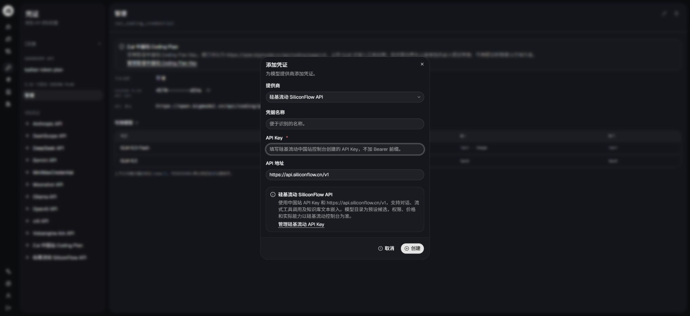

# 硅基流动凭据接入验收

仅修改 backend 与 frontend，使用框架的凭据和模型扩展点，未修改 AgentScope 源码。

## 接入范围

- 新凭据类型：`siliconflow_credential`，页面显示「硅基流动 SiliconFlow API」。
- 默认中国站地址：`https://api.siliconflow.cn/v1`；各凭据独立保存 Key 和地址。
- 对话预设：`deepseek-ai/DeepSeek-V4-Flash`、`Pro/deepseek-ai/DeepSeek-V4`，支持流式输出、思考内容、工具调用及工具结果回传。
- 文本嵌入：Qwen3 Embedding 0.6B、4B、8B 和 BGE M3，复用知识库创建、索引、持久化与检索流程。
- Qwen3 按模型卡发送所选维度，BGE M3 固定 1024 维且不发送 dimensions；嵌入请求直接使用该凭据的 API 地址。
- 创建、编辑、详情均有中英文使用说明和 Key 管理入口。

预设模型不是实时账号权限探测；对话模型采用保守的 64K 上下文项目配置。实际模型权限、价格和服务能力以硅基流动控制台为准。

## 验证结果

- 后端 60 项回归测试通过，包括新增 5 项硅基流动测试。
- 新增测试使用真实 OpenAI SDK 和离线 HTTP 响应，覆盖鉴权头、可配置端点、思考参数、流式工具片段、工具结果回传、嵌入维度、分批及返回顺序。
- 真实框架路由和临时 SQLite/Qdrant 验证：注册登录、创建凭据、上传 TXT、索引、持久化向量及查询；其他账号访问该凭据或知识库返回 404。
- 原知识库文档格式、跨进程向量恢复、SkillHub、MCPHub、认证和 OFDM 测试通过。
- 前端 19 项测试、TypeScript、改动文件 ESLint 和 Vite 生产构建通过。
- 后端已重启，当前真实服务可返回新增凭据 Schema、2 张对话模型卡和 4 张嵌入模型卡。
- 启用前后 32 个现有业务键、95 个工作区及文档文件的内容摘要一致，molldy 到 study 的绑定保留。
- 浏览器确认新增入口和创建表单，名称与 Key 保持空白，默认地址正确。没有创建含测试 Key 的正式凭据，也没有调用付费模型 API。

## 使用

在凭证页面选择「硅基流动 SiliconFlow API」，粘贴自己在[中国站控制台](https://cloud.siliconflow.cn/account/ak)创建的 Key。
保存后可在会话中选择其对话模型，或新建知识库并选择其文本嵌入模型。旧知识库不自动切换模型。

依据：[快速开始](https://api-docs.siliconflow.cn/docs/userguide/quickstart)、[Chat Completions](https://api-docs.siliconflow.cn/docs/api/chat-completions-post)、[Embeddings](https://api-docs.siliconflow.cn/docs/api/embeddings-post)。
